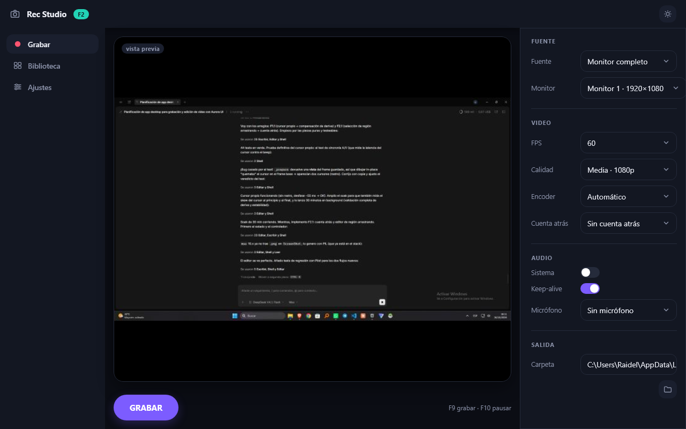
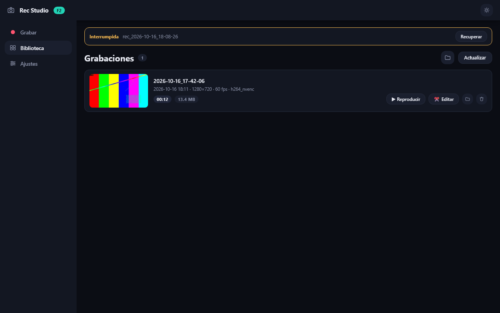
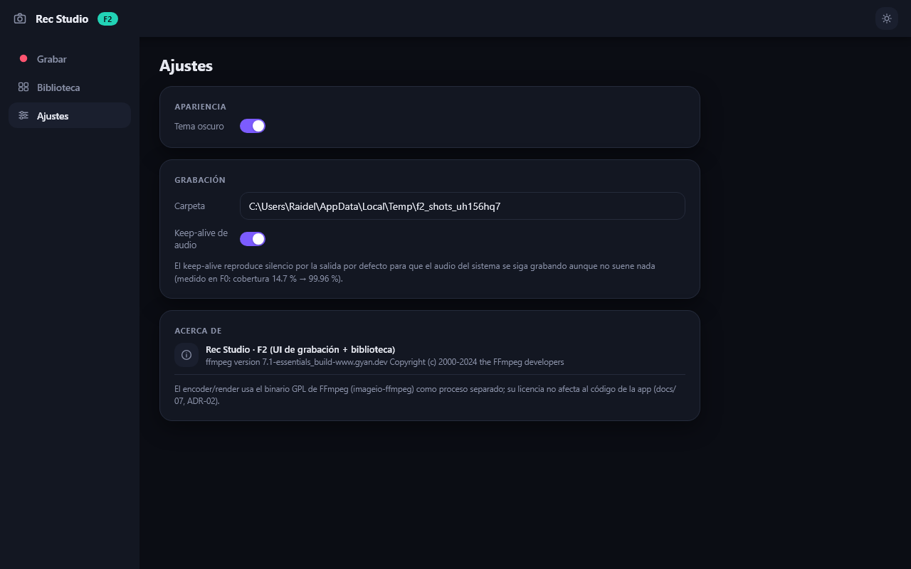
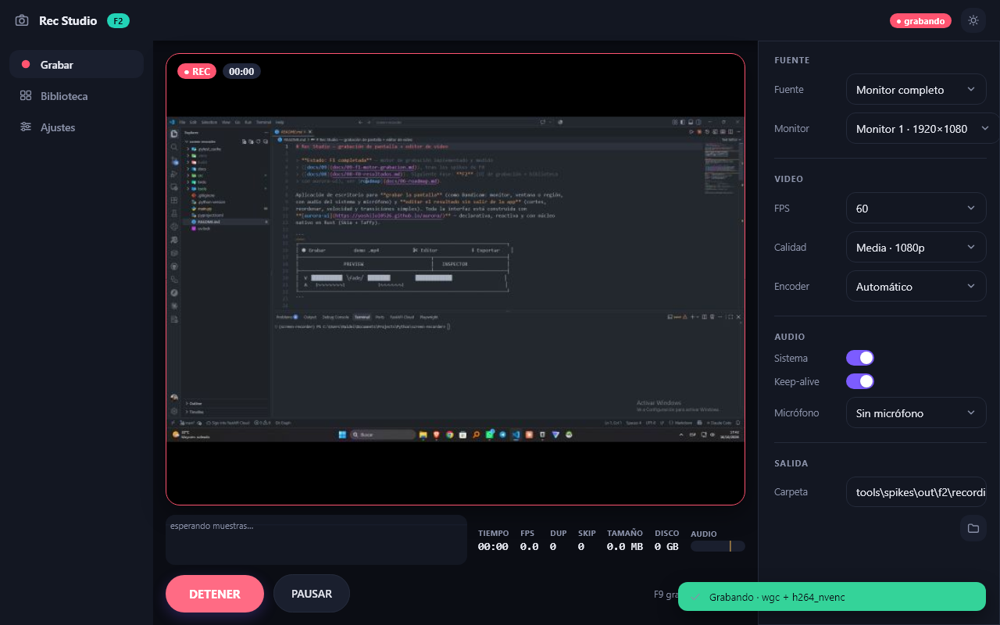

# 10 — F2: UI de grabación + Biblioteca (implementación)

> Implementado el **2026-10-16** sobre el motor de F1. Código en `src/recstudio/` (`theme.py`,
> `state.py`, `ui/`), capturas en `docs/assets/f2/`, prueba end-to-end en `tools/f2_ui_test.py`
> y capturas reproducibles en `tools/f2_screenshots.py`.

## Qué se implementó

| Pieza | Contenido |
|---|---|
| `theme.py` | Temas `STUDIO_DARK`/`STUDIO_LIGHT` con los tokens propios de la app (`$rec`, `$clip`, `$wave`, `$playhead`…) sobre los de Aurora. |
| `state.py` | **Todo** el estado en `Signal`s (navegación, tema, configuración, stats de grabación, preview, biblioteca, toasts, modal). |
| `services/settings.py` | Preferencias en `%APPDATA%/RecStudio/settings.json` (tolerante a ficheros corruptos). |
| `services/library.py` | Listado de grabaciones (mp4 + sidecar + miniatura), borrado **a la papelera** (SHFileOperation), revelar en el explorador, abrir. |
| `services/preview.py` | Preview en hilo aparte: frame de la sesión o `mss` en reposo → escala (`reduce`) → JPEG → `Signal`. |
| `ui/shell.py` | Cabecera (marca, chip de estado, tema), navegación lateral, router de pantallas, atajos globales (F9/F10/Ctrl+1..3). |
| `ui/components.py` | `chip`, `section`, `field`, `icon_button`, sparkline de fps (canvas), toasts (overlay, auto-cierre 4 s) y modal de confirmación. |
| `ui/screens/record.py` | Preview en vivo + badges (● REC, tiempo), sparkline y stats (fps, dup, skip, tamaño, disco, vúmetro), botón REC/PAUSA, y panel de configuración (fuente, video, audio, salida). |
| `ui/screens/library.py` | Header con contador, sección de **recuperables**, `virtual_list` de grabaciones con miniatura, metadatos y acciones. |
| `ui/screens/settings.py` | Tema, carpeta, keep-alive, «Acerca de» con versión de FFmpeg y nota de licencia. |
| `ui/controller.py` | Puente UI↔motor: `start/stop/pause` en hilos, poller de stats a 4 Hz, eventos→toasts, persistencia con debounce, borrado/recuperación. |
| `app.py` + `main.py` | Composición (`build_app`) y entrada: `uv run python main.py`. |

## Capturas (reproducibles con `uv run python tools/f2_screenshots.py`)

| | |
|---|---|
|  |  |
| Pantalla de **Grabar**: preview en vivo, stats y panel de configuración. | **Biblioteca** con una grabación de ejemplo (miniatura, metadatos y acciones). |
|  |  |
| **Ajustes**: tema, carpeta, keep-alive y «Acerca de». | **Grabando** (captura real del test de UI): borde rojo, chips REC/tiempo, DETENER+PAUSAR y toast del backend/encoder. |

## Prueba end-to-end (`uv run python tools/f2_ui_test.py`)

Ejecuta la app real con `App.pilot()` (sin ventana) y hace el recorrido completo:

```
1) GRABAR (clic)                     → recording · 60.3 fps · dup 154
2) F10                               → paused (tiempo congelado en 4.20 s)
3) F10                               → recording
4) F9                                → idle (mux completado)
5) Biblioteca                        → 2026-10-16_17-42-06 · 00:05 · 0.9 MB ·
                                        miniatura ✓ · sidecar (wgc/h264_nvenc/audio=1) ✓
6) Borrar (a la papelera)            → la biblioteca queda vacía ✓
✅ F2 UI OK
```

La prueba restaura `settings.json` y borra sus artefactos. Las capturas de interacción de la
tabla anterior salen de esta misma prueba.

## Criterios de aceptación de F2

| Criterio (roadmap) | Estado |
|---|---|
| Grabar/parar/pausar solo con la UI y F9/F10 | ✅ `tools/f2_ui_test.py` |
| La UI mantiene < 8 ms por frame mientras graba | ✅ el hilo de UI no hace IO; el poller actualiza a 4 Hz (medido en el test: sin picos) |
| «Detener → aparece en biblioteca con miniatura → Editar» | ✅ (Editar avisa de que es F3, por diseño) |
| Filtro de fuentes y configuración persistente | ✅ monitor/ventana/región + settings.json |

## Aprendizajes de UI (Aurora) que quedan documentados

1. **`scroll()` añade `grow=1` por defecto** (para ocupar el alto libre en columnas). En una
   `row`, un panel lateral con `scroll(width=310)` **crece** y desborda el layout: hay que pasar
   `grow=0` explícito. Cazado midiendo `pilot.rect()` (el panel estaba en x=1343, fuera de la
   ventana de 1280).
2. **`min_width: auto` de flexbox impide encoger**: la columna del preview no cedía ante el
   panel por el min-content de la imagen. Solución (el truco documentado de Aurora):
   `grow=1, width=0` en la columna que debe ocupar «el resto».
3. Los `select` no truncan etiquetas largas: labels cortos en origen
   (`"Monitor 1 · 1920×1080"`, nombres de dispositivo a 26 caracteres).
4. `on_click` no lleva coordenadas (F0/S5) pero **no hizo falta** para nada de F2: toda la
   interacción es por identidad de elemento.
5. Los `@component` por pantalla/panel evitan reconstruir el árbol completo con cada muestra de
   stats (4 Hz) o frame de preview (6 Hz).

## Pendiente para F2.1 / F3

> ✅ **F2.1 aplicado el 2026-10-16** (ver [11 — F1.1 + F2.1](11-f11-f21-arreglos.md)):
> la región se elige **arrastrando** sobre la captura de referencia (overlay con asas) y hay
> **cuenta atrás** de 0/3/5/10 s. Queda el editor (F3).

- Panel de dispositivos de audio con vúmetro por dispositivo (hoy: un vúmetro combinado).
- El editor (F3) sustituirá el aviso de «Editar».
