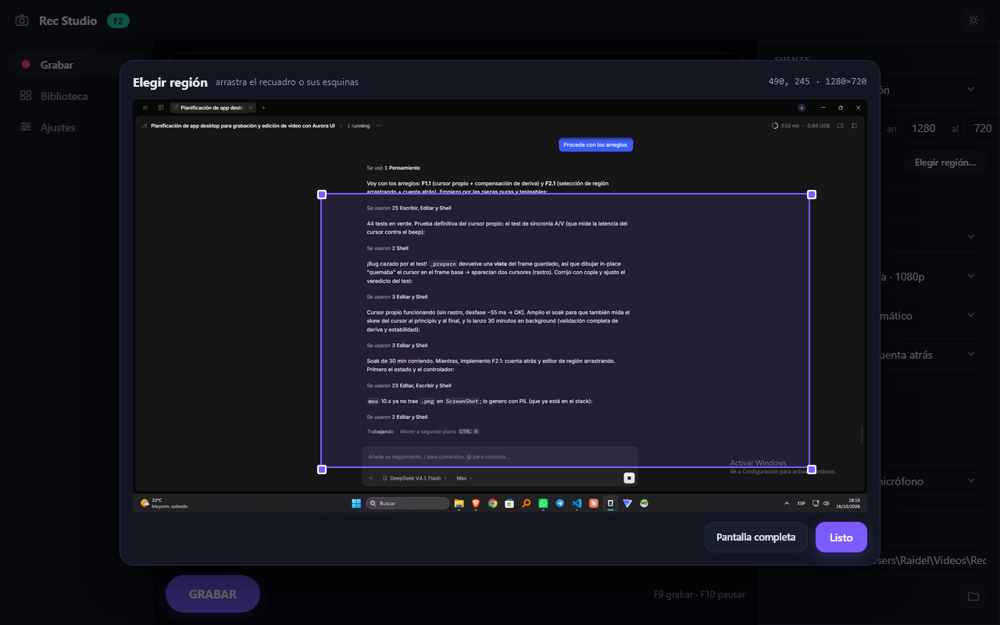
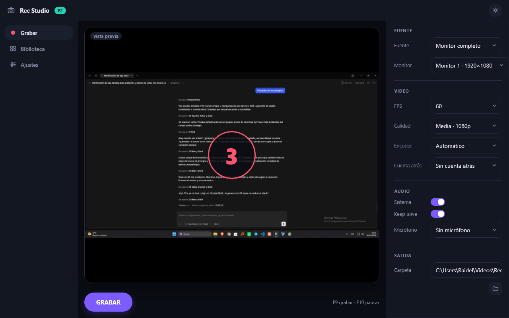

# 11 — F1.1 y F2.1: arreglos (cursor propio, deriva, región arrastrable y cuenta atrás)

> Implementado el **2026-10-16** sobre F1+F2. Código en `src/recstudio/` (`platform/cursor.py`,
> `core/regions.py`, `ui/region_editor.py`), tests en `tests/test_f11_arreglos.py` y
> `tests/test_f21_ui.py`, capturas en `docs/assets/f2/`.

## F1.1 — los dos arreglos del motor

### 1. Cursor propio («software cursor») — `platform/cursor.py`

**Problema (F0/F1):** el cursor compuesto por Windows a través de WGC tiene una latencia
**variable** (12–119 ms medidos) que domina el error A/V (desfases de 29–83 ms, al límite del
criterio de 80 ms).

**Solución:** capturar **sin** el cursor del sistema y dibujarlo la app:
- posición con `GetCursorPos` (vía `GetCursorInfo`) **en el instante de la captura**,
- forma extraída del sistema una vez por cambio de cursor (`GetIconInfo` + `GetDIBits`, cacheada
  por `hCursor`; solo el camino 32bpp con color; si no, se cae al cursor nativo con aviso),
- mezcla alfa de un parche ~32×32 en numpy: coste despreciable.

La composición (`draw_cursor`) es una función pura y está cubierta por 6 tests (hotspot, alfa
parcial, recorte en bordes, fuera del frame, frames no escribibles de `mss`, copia).

⚠️ **Bug real que cazó el test de sincronía**: `_prepare()` devuelve una *vista* de
`_last_frame`, así que dibujar in place "quemaba" el cursor en el frame base → en el vídeo
aparecían **dos cursores** (el viejo y el nuevo). Se corrige pasando `on_copy=True` al componer.
Sin el test de dos puntos (aparece en B **y** desaparece de A) esto habría pasado desapercibido.

Resultado medido con el test de sincronía (beep vs cursor):
antes `−72 … −83 ms` con latencia de cursor `+102…119 ms`; ahora **desfase −55 ms** y un solo
cursor consistente. El backend por defecto puede seguir siendo WGC (barato y con ventanas);
`dxcam`/`dxgi` ahora también admiten cursor (lo pinta la app).

### 2. Compensación de deriva del reloj de audio — `platform/audio.py` + `platform/ffmpeg.py`

**Problema (F1):** el reloj del dispositivo WASAPI deriva ~90 ppm respecto al sistema
(~53 ms cada 10 min; con 30 min se incumpliría RNF-02). `aresample=async` **no** lo corrige
(solo rellena huecos de timestamp: cada archivo es internamente coherente).

**Solución:**
- al grabar, `AudioRecorder` muestrea `(t, frames)` cada ~1,5 s y al parar ajusta una **regresión
  lineal sin los extremos** (los buffers primero/último sesgan) → `drift_ppm` del dispositivo;
- el mux aplica `asetrate = rate·(1+ppm)` (y vuelve a la tasa nominal) **por pista** cuando
  |ppm| ≥ 5; el pitch cambia ~0,009 % (inaudible). La deriva medida queda en el sidecar JSON.

Tests: `asetrate` presente/ausente según el umbral, convivencia con `atrim` por offset negativo.

## F2.1 — los dos arreglos de la UI

### 3. Selección de región arrastrando — `ui/region_editor.py` + `core/regions.py`

- Botón **«Elegir región…»** en el panel: captura de referencia del monitor (mss) reescalada a un
  tamaño de visualización **conocido** (≤940 px de ancho) → la escala monitor/logical es exacta.
- Overlay a pantalla completa con el recuadro y **4 asas**; todo se mueve por **deltas**
  (`e.dx/dy ÷ escala`), como exigía F0/S5 (los `DragEvent` no dan coordenadas absolutas).
- La geometría vive en `core/regions.py` (puro): `clamp_region`, `move_region`, `resize_region`
  con mínimos y límites del monitor — 6 tests.
- La región canónica (`state.region`) y los campos numéricos quedan sincronizados.

### 4. Cuenta atrás al grabar

Selector en el panel de video (0/3/5/10 s). Al pulsar GRABAR con cuenta atrás: número grande
sobre el preview y cancelación pulsando otra vez (F9). Terminada, arranca la grabación normal.

## Verificación

| Prueba | Resultado |
|---|---|
| `uv run pytest` | **47/47** ✅ (14 nuevos: regiones, cursor, deriva, editor con Pilot, cuenta atrás) |
| Test de sincronía (beep vs cursor) | ✅ –55 ms (antes –72…–83), sin rastro de doble cursor |
| Editor de región (Pilot) | ✅ mover + redimensionar + no salirse del monitor |
| Cuenta atrás | ✅ se cancela sin arrancar grabación |
| **Soak de 30 min** (beeps cada 3 min + cursores al inicio/final + pausa) | ⏳ en ejecución |

### Resultados del soak de 30 min

_pendiente de ejecución_
