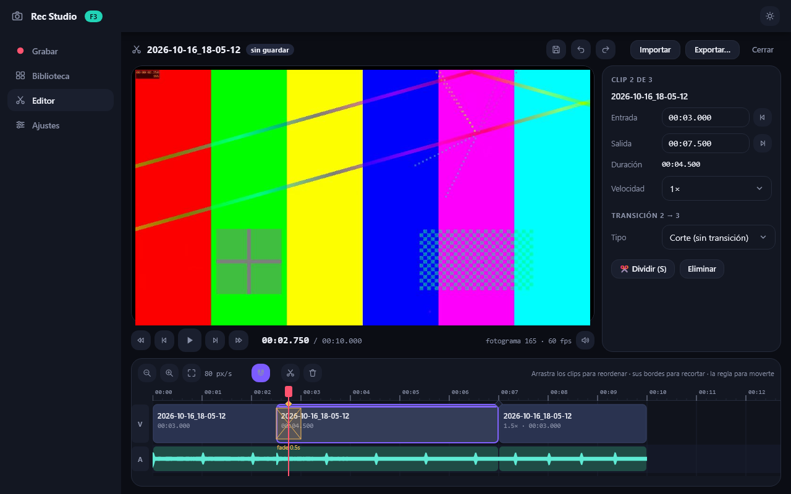
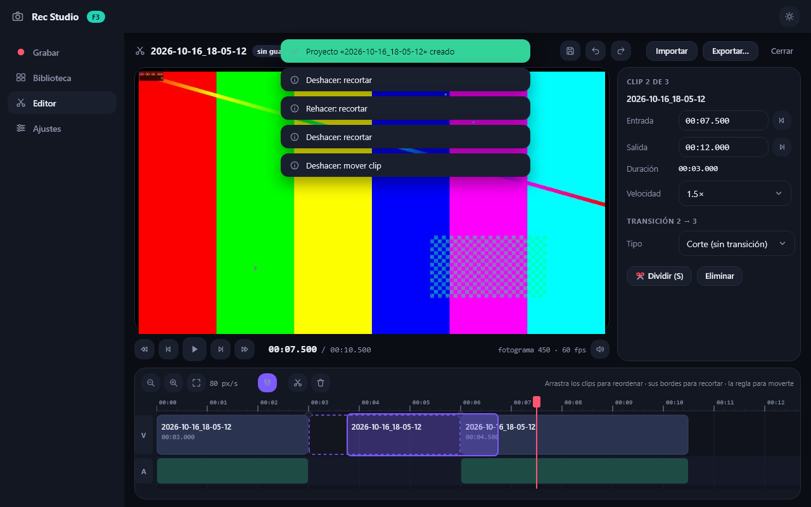
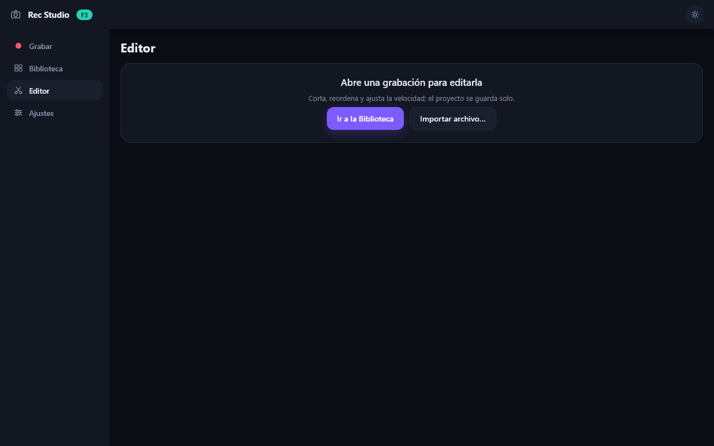
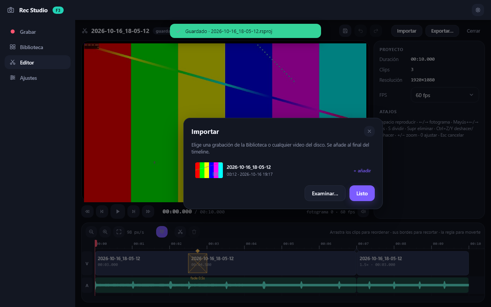

# 12 — F3: editor (modelo, timeline y preview)

> Implementado el **2026-10-16** según el diseño de [04 — Editor](04-editor.md) y
> [05 — UI con Aurora](05-ui-aurora.md). Prueba de aceptación en `tools/f3_editor_test.py`,
> capturas en `docs/assets/f3/` y 40 tests nuevos (`tests/test_f3_core.py`,
> `tests/test_f3_editor.py`).

## Qué se implementó

| Pieza | Contenido |
|---|---|
| `core/project.py` | Modelo `frozen` (`MediaAsset`, `Effect`, `Transition`, `Clip`, `Track`, `Project`), invariantes de docs/04 (`Project.validate`, límite de transición `min(dₐ, d_b)/2`), serialización `to_dict`/`from_dict`. |
| `core/timeline.py` | Matemática pura: `clip_starts`, `total_duration` (Σd − Σt), `locate`, `transition_at`, conversiones x↔t, `frame_round`, `format_time`/`parse_time`; operaciones `split`, `trim`, `move`, `drop_index`, `ripple_delete`, `set_speed`, `set_transition`, `append_clip`; `snap` en píxeles y sus candidatos. |
| `core/store.py` | `ProjectStore`: undo/redo por snapshots (límite 50), transacciones de drag (`begin/update/commit/cancel`), autosave (30 s y solo si está sucio), guardado atómico con `.bak`, `migrate` (schema más nuevo ⇒ solo lectura), nombres de carpeta seguros. |
| `services/media.py` | `probe` (PyAV), waveform min/max a 100 buckets/s con cache `.npz`, `waveform_slice` para el dibujo, pósters JPEG cacheados. |
| `services/playback.py` | `VideoSource` (seek a keyframe + decode secuencial sin seeks), `DecoderPool` (LRU, ranuras por paridad de clip), `FrameRenderer` (letterbox + 8 transiciones aproximadas en numpy), `Player` (reloj a 30 Hz, descarta ticks, precarga del clip siguiente), `AudioPreview` (best-effort con `sounddevice`). |
| `platform/dialogs.py` | Diálogo «Abrir» nativo de Windows (`GetOpenFileNameW`, multiselección) para importar. |
| `ui/editor_controller.py` | Comandos, drags, transporte, atajos y toda la IO del editor (en hilos). |
| `ui/timeline.py` | Timeline: canvas + capa de cajas interactivas dentro de un `scroll` horizontal; playhead en su propio componente. |
| `ui/screens/editor.py` | Barra de proyecto, preview, transporte, inspector (clip / transición / proyecto), timeline, estado vacío con proyectos recientes y modal de importar. |
| Integración | Entrada «Editor» en la navegación (Ctrl+3; Ajustes pasa a Ctrl+4), «✂ Editar» de la Biblioteca abre (o crea) el proyecto de la grabación, el último proyecto se reabre al arrancar. |

Los proyectos se guardan en `<carpeta de grabaciones>/Proyectos/<nombre>.rsproj/project.json`.

## Capturas (reproducibles con `uv run python tools/f3_editor_test.py`)

| | |
|---|---|
|  |  |
| 3 clips con fundido de 0.5 s (rombo + zona de solape) y el tercero a 1.5×; el preview está en mitad del fundido. | **Moviendo** un clip: fantasma morado, hueco discontinuo donde caerá y el resto ya reordenado en vivo. |
|  |  |
| Estado vacío con acciones (y proyectos recientes cuando los hay). | Importar: grabaciones de la Biblioteca o «Examinar…» (diálogo de Windows). |

## Prueba de aceptación (`uv run python tools/f3_editor_test.py`)

```
1) Biblioteca → ✂ Editar                 ✓ se crea y abre el proyecto
2) Tres clips con cortes exactos         ✓ cortes [(0.0, 3.0), (3.0, 7.5), (7.5, 12.0)]
   + transición + velocidad              ✓ duración total 10.000 s (Σd − Σt)
3) Drags con undo                        ✓ trim −1 s · undo exacto · mover al final · undo exacto
                                         ✓ Esc cancela el drag sin dejar rastro
4) Reproducción (Espacio)                ✓ preview a 30.1 fps (render p50 3.8 ms · p95 21.7 ms)
5) Guardar (Ctrl+S), cerrar y reabrir    ✓ el proyecto reabierto es idéntico
✅ F3 editor OK
```

## Criterios de aceptación de F3

| Criterio (roadmap) | Estado |
|---|---|
| Montar 3 clips con cortes exactos | ✅ `split` corta en frontera de frame; test con 1080p60 y 360p30 |
| Previsualizarlos a ≥ 24 fps | ✅ 30 fps medidos con la app real (1080p60 → 960×540, transición incluida) |
| Todos los drags con undo correcto | ✅ trim izquierdo/derecho y mover: una entrada de undo por gesto, Esc restaura el snapshot, un clic no apila nada |
| Abrir/cerrar proyecto preserva estado | ✅ igualdad exacta del `Project` tras guardar → cerrar → abrir; `.bak` si el JSON se corrompe |
| RNF-04 / «sensación» del timeline | ✅ `draw` del timeline 5.8 ms con 100 clips en desarrollo (test de regresión: frame < 30 fps + culling, sin umbral absoluto — ver docs/05); mover el playhead no redibuja el canvas. La sensación con ratón real queda para validar a mano en la ventana. |

## Mediciones

| Qué | Resultado |
|---|---|
| Render de un frame del preview (1080p60 → 960×540, decode + escala swscale + JPEG) | p50 **3.8 ms**, p95 21.7 ms (los picos son cambios de clip) |
| Escalado dentro del decode (`to_ndarray(width, height)`, swscale) | ~1.2 ms/frame frente a 5.8 ms de `Image.reduce(2)` de F0 (S4): sustituye a PIL en el editor |
| Seek aleatorio + frame | ~42 ms (scrub viable) |
| Reproducción con el `Player` | 30.2 fps estables (antes del arreglo de abajo: 21 fps) |
| `draw` del timeline con 100 clips + waveforms | 5.8 ms a 20 px/s (todos visibles), 1.1–1.7 ms a 60–240 px/s |
| Frame de UI con el playhead moviéndose (30 Hz) | ~2 ms total, canvas sin redibujar |

## Bugs reales encontrados

1. **`Condition.wait` va a saltos de ~15.6 ms en Windows**: el `Player` esperaba el siguiente
   tick con `Condition.wait(0.027)` y dormía ~31 ms ⇒ 21 fps. Ahora usa una rejilla fija de
   ticks con `time.sleep` (alta resolución desde Python 3.11) y descarta ticks si va tarde.
2. **Cambio de clip = seek del mismo decoder**: tras un `split`, dos clips consecutivos son el
   mismo archivo y compartían decoder ⇒ cada corte costaba un seek (~80 ms) y en las
   transiciones se peleaban saliente y entrante. Las ranuras del `DecoderPool` van por paridad
   del índice del clip, y el clip siguiente se **precarga** en otro hilo 0.7 s antes.
3. **El playhead tapaba las asas de trim**: justo después de dividir, el playhead está en el
   borde de los clips y su caja de 12 px se quedaba los clics. En Aurora 0.3 **cualquier caja
   encima bloquea los clics aunque no tenga handlers**: la línea mide 2 px y el asa solo vive en
   la regla.
4. **Los toasts bloqueaban el timeline/inspector** durante 4 s por la misma razón (caja en la
   capa overlay). Ahora salen arriba al centro, sobre el preview, en un contenedor de 0 px de
   alto (los toasts desbordan hacia abajo y fuera de ellos los clics pasan); máximo 3 a la vez.
5. **Los atajos de una tecla se disparaban escribiendo en un campo**: Aurora entrega la tecla al
   `on_key` de la raíz aunque haya un campo enfocado (y no hay forma de saber el foco desde un
   handler). Los campos del inspector marcan sus pulsaciones (`mark_input_key`) y la raíz las
   deja pasar si son teclas sin modificador.
6. `KeyEvent.matches("+")` y `matches("minus")` lanzan excepción (`"+"` es el separador de
   combinaciones): el zoom con `+`/`-`/`0` se lee de `e.text`.

## Aprendizajes de UI (Aurora 0.3)

1. **Sí hay «clic en la regla → ir a ese t»**, contra lo que concluyó F0: un `on_drag` recibe la
   fase `start` también con un simple clic, con la `x` de ventana. Como todo lo que hay a la
   izquierda del timeline tiene ancho fijo (`TL_X0 = nav + padding + borde + etiquetas`), se
   convierte a x de contenido sumando el `scroll` (que llega por `on_scroll`). Un test fija que
   `TL_X0` coincide con el layout real.
2. **Funciones de dibujo de módulo**: el canvas recibe siempre la misma función (`_draw_tracks`),
   así Aurora conserva el dibujo mientras no cambie ningún `Signal` que lea. El playhead es otro
   `@component` (una caja absoluta): a 30 Hz solo se mueve esa caja.
3. No hay scroll programático en 0.3 (solo el del usuario y `scroll_offset` del Pilot): el zoom
   no puede mantener el playhead a la vista. Mitigación: «Ajustar» (0) y zoom al importar.
   *Mejora propuesta a Aurora: `scroll_to`/offset controlado en `scroll()`.*
4. `pilot.click(key)` usa los rects del **último frame pintado**: tras un cambio de modelo hay
   que avanzar un frame antes de clicar (en tests).

## Decisiones y convenciones fijadas

- **Audio en los solapes**: dentro de una transición suena el clip saliente hasta su final y el
  entrante empieza en `t_local = duración de la transición`; el audio dura exactamente lo mismo
  que el video. El export de F4 debe seguir la misma convención (`atrim` del inicio del entrante).
- **Mover un clip** quita sus transiciones (las de su hueco viejo y las del nuevo): los vecinos
  quedan con un corte limpio. **Dividir** reparte: el izquierdo conserva la entrante, el derecho
  hereda la saliente, la frontera nueva nace sin transición.
- **Trim mínimo de 1 frame** del proyecto; solo se redondea a frame (de la fuente) el borde que
  se mueve. Durante un trim izquierdo el borde sigue al ratón y el hueco se cierra al soltar.
- Lo **no incluido en F3** (va con F4 o post-v1): efectos (eq/volumen/fades), pistas de audio
  independientes (el modelo ya las tiene), reubicar archivos offline (hoy se marcan y se dibujan
  discontinuos), loop de la selección (`L`) y la tira de miniaturas en los clips.
