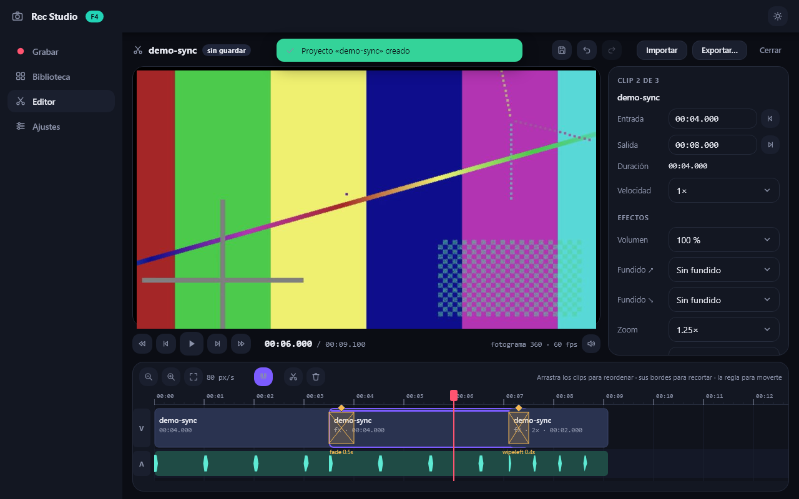
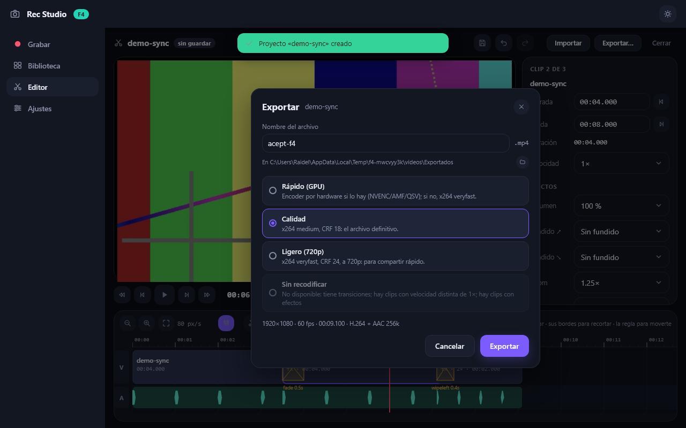
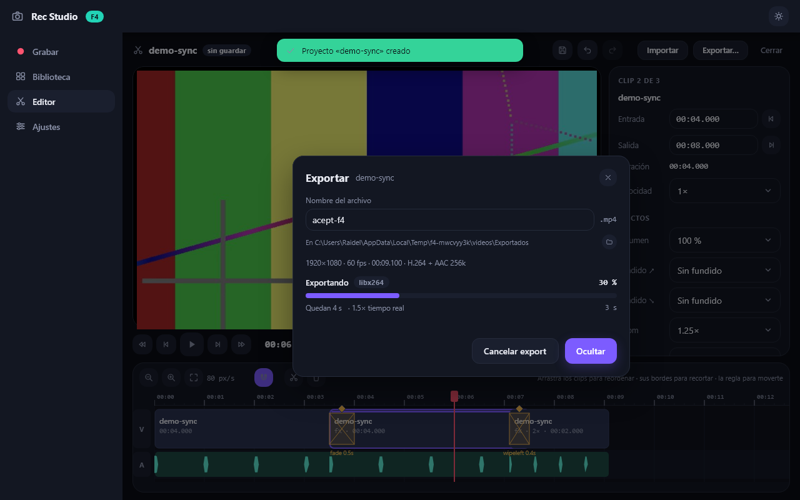
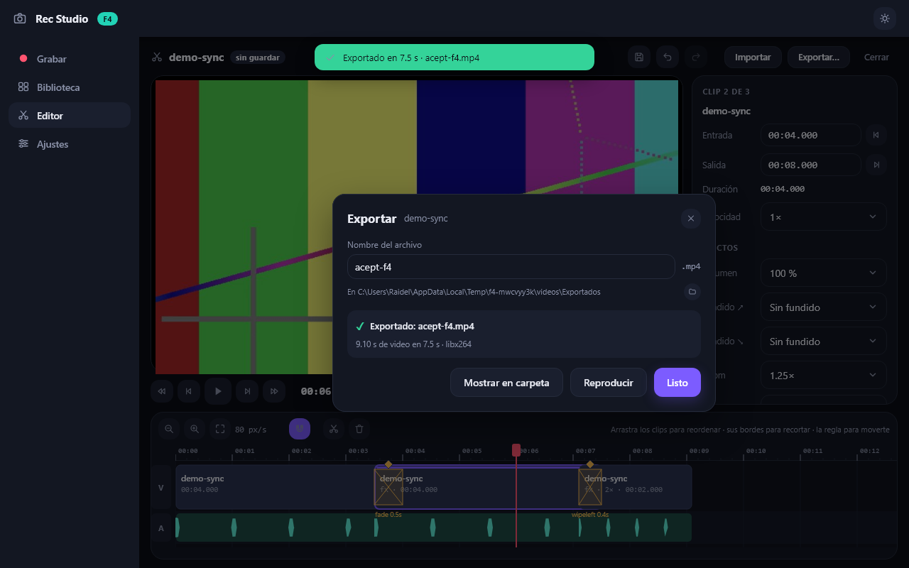

# 13 — F4: export, transiciones y efectos

> Implementado el **2026-10-16** según el diseño de [04 — Editor](04-editor.md) (sección
> «Export»). Prueba de aceptación en `tools/f4_export_test.py`, capturas en `docs/assets/f4/` y
> 30 tests nuevos (`tests/test_f4_graph.py`: puros + golden; `tests/test_f4_export.py`: FFmpeg
> real, preview y UI con Pilot).

## Qué se implementó

| Pieza | Contenido |
|---|---|
| `core/effects.py` | Efectos por clip (como mucho uno de cada tipo): `eq` (brillo/contraste/saturación), `volume`, `fade_in`/`fade_out` (imagen a negro + audio), `zoom` (recorte centrado). Lectura con valores neutros, edición (`set_effect`, `clear_effects`; un efecto neutro se elimina) y las curvas de fundido que comparten preview y export. |
| `core/graph.py` | Builder puro del comando de render: presets (`rapido`, `calidad`, `ligero`, `copia`), cadena por clip de video y de audio, composición con `concat`/`xfade`, mezcla de pistas de audio extra (`amix`), argumentos del encoder (NVENC/AMF/QSV/x264). Golden test con el ejemplo de docs/04. |
| `core/keyframes.py` | «Corte rápido» sin recodificar: motivos que lo bloquean, plan de segmentos con el inicio imantado al keyframe más cercano, comandos `-c copy` por segmento y `concat` final. |
| `services/export.py` | `Exporter`: hilo con máquina de estados `preparing → rendering → verifying → done` (o `cancelled`/`error`), progreso por `-progress pipe:1`, ETA con media móvil de 20 ticks, cancelar (`terminate` + borrar parcial), verificación con `probe_media`, escritura en `.part.mp4` y renombrado al final, reintento con x264 si el encoder por hardware falla. |
| `services/media.py` | `keyframes(path)`: índice de keyframes por demux (sin decodificar), cacheado en `cache/keyframes`. |
| `services/playback.py` | El preview aplica los mismos efectos: zoom (recorte + reescalado), `eq` aproximado en RGB, fundido de imagen por clip y volumen/fundidos en el audio (`fade_envelope`). |
| `ui/export_modal.py` | Modal «Exportar» (Ctrl+E): nombre, carpeta, presets (el de «sin recodificar» deshabilitado con el motivo), resumen, barra de progreso con ETA y velocidad, cancelar, «Reproducir» y «Mostrar en carpeta». Se puede ocultar con un export en marcha: la barra del editor muestra un chip con el %. |
| `ui/screens/editor.py` | Sección «Efectos» del inspector (volumen, fundidos, zoom, brillo, contraste, saturación, «Quitar efectos»), volumen del audio original en «Proyecto», botón «Reubicar…» en clips offline. El timeline marca `fx` en los clips con efectos. |
| `ui/editor_controller.py` | Comandos de efectos con undo, `set_track_gain`, export (abrir/iniciar/cancelar/abrir resultado) y `relocate_to` (reubicar un asset offline comprobando que el archivo nuevo dura lo suficiente). |

Las exportaciones van a `<carpeta de grabaciones>/Exportados/<nombre>.mp4` (sin pisar: ` (2)`, ` (3)`…).

## Capturas (reproducibles con `uv run python tools/f4_export_test.py`)

| | |
|---|---|
|  |  |
| Inspector con la sección «Efectos» (clip con zoom 1.25× y saturación 0.5×, visibles en el preview). | Modal de export: presets; «Sin recodificar» deshabilitado con el motivo. |
|  |  |
| Exportando: porcentaje, ETA, velocidad respecto al tiempo real y encoder. | Terminado y verificado: reproducir o mostrar en la carpeta. |

## Prueba de aceptación (`uv run python tools/f4_export_test.py`)

```
1) 3 clips + 2 transiciones + velocidad + efectos → Exportar desde la UI
   ✓ 546 frames (esperados 546: ±1) · 9.100 s vs modelo 9.100 s
   ✓ audio de 9.100 s (igual que el video)
   ✓ A/V en sync: 7 marcas, desfase máx. 10.0 ms
   ✓ H.264 High yuv420p + AAC 48 kHz (reproducible en móvil)
   ✓ faststart: moov antes que mdat
2) Cancelar borra el parcial                ✓ sin archivos parciales
3) Corte rápido sin recodificar (byte a byte)
   ✓ export sin recodificar: done en 0.26 s
   ✓ 480 paquetes de video idénticos a los de la fuente (480 esperados)
4) 1 min de 1080p60 con el preset Rápido (NVENC)
   ✓ 59.0 s de 1080p60 en 12.9 s con h264_nvenc (4.6× tiempo real; RNF-05 < 40 s)
✅ F4 export OK
```

La sincronía se mide con una fuente que pinta un cuadro blanco y emite un pitido de 1 kHz en los
primeros 50 ms de cada segundo; en el resultado se emparejan destellos y pitidos. Los 10 ms son
el suelo del propio detector (ventanas de 5 ms y AAC): la fuente sin editar mide lo mismo.

## Criterios de aceptación de F4

| Criterio (roadmap) | Estado |
|---|---|
| 3 clips, 2 transiciones y velocidad: duración ±1 frame | ✅ frame **exacto** (546/546), también en el test con clips reordenados del mismo archivo |
| Audio en sync | ✅ ≤ 10 ms (el suelo del detector); el audio dura lo mismo que el video |
| Reproducible en un móvil y en Windows | ✅ H.264 High, yuv420p, AAC 48 kHz, `+faststart` comprobados en el archivo. La reproducción en un móvil físico queda para validar a mano. |
| 1 min 1080p60 < 40 s con NVENC (RNF-05) | ✅ 12.9 s (4.6× tiempo real) |
| Corte rápido idéntico byte a byte en los tramos conservados | ✅ paquetes de video idénticos (hash por paquete) |

## Mediciones

| Qué | Resultado |
|---|---|
| Export 59 s 1080p60, 3 clips + fundido de 1 s, NVENC (`p5`, `cq 21`) | 12.9 s (4.6×) |
| Export 9.1 s 1080p60 con efectos y 2 transiciones, x264 `medium` CRF 18 | 5.0 s |
| Corte rápido de 8 s (2 segmentos + concat) | 0.26 s |
| Indexado de keyframes (demux, 12 s 1080p60) | 88 ms la primera vez; luego cache en disco |

## Bugs reales encontrados

1. **El demuxer `concat` modifica los keyframes H.264**: con `auto_convert=1` (por defecto)
   inserta `h264_mp4toannexb` y cada keyframe sale con SPS/PPS en banda (36 bytes más). El
   resultado se reproduce, pero ya no es «idéntico byte a byte». Se pasa `-auto_convert 0`
   (todos los segmentos salen del mismo archivo, con el mismo extradata).
2. **Desfase acumulado de audio por redondeos**: con `fps=` cada clip dura un número entero de
   frames, pero `atrim` es exacto a la muestra; con muchos clips de duración no múltiplo del
   frame el audio derivaba. Ahora cada clip de video se fija a `round(d·fps)` frames
   (`tpad=stop_mode=clone` + `trim=end_frame=N`) y su audio se rellena/recorta a esa misma
   duración (`apad=whole_dur` + `atrim=duration`). Los offsets de `xfade` se calculan en frames.
3. **El inspector alto empujaba el timeline fuera de la ventana**: con la sección «Efectos» el
   contenido del inspector supera la altura disponible y la fila `grow=1` crecía en vez de
   hacer scroll. Necesita `height=0` (base 0) para encoger, igual que la regla `width=0` de las
   columnas (docs/05).
4. **Controladores viejos reaccionando a `Signal` globales** (tests): `subscribe` no se puede
   deshacer y, con varias apps en el mismo proceso, el `EditorController` de un test anterior
   aplicaba los cambios del inspector a *su* proyecto y publicaba `editor_project`/`selection`.
   Los handlers del editor ignoran los eventos tras `shutdown`.

## Decisiones y convenciones fijadas

- **Una entrada por clip** (`-ss IN -t LEN -i archivo`) en lugar de una por archivo: el seek de
  entrada es preciso al transcodificar, FFmpeg solo decodifica el tramo útil y no se acumulan
  frames en memoria cuando un archivo aparece varias veces o en otro orden. Por eso la cadena
  ya no lleva `trim=start:end` (docs/04 actualizado).
- **Duraciones en frames enteros** (ver bug 2): la duración del export es
  `(Σ round(dᵢ·fps) − Σ round(tᵢ·fps)) / fps`; difiere del modelo como mucho medio frame por clip
  y coincide exactamente cuando los cortes están en frontera de frame (lo habitual: `split` y
  `trim` redondean a frame).
- **Audio en las transiciones**: el mismo criterio que el preview de F3 (suena el saliente hasta
  su final; el entrante arranca tras el solape). Micro-fundidos de 30 ms en las fronteras
  internas para evitar clics.
- **Fundidos del clip**: imagen a/desde negro y audio a la vez, acotados a la duración del clip
  (si no caben los dos, se reparten). Al dividir un clip, el izquierdo conserva el de entrada y
  el derecho el de salida; el volumen y el color se copian a los dos.
- **Volumen del audio original** (`Track.gain`/`muted` del track de video): multiplica el
  volumen de cada clip; a 0 el export no lleva pista de audio si no hay otra fuente.
- **Corte rápido**: solo si no hay transiciones, efectos, velocidad ≠ 1, cambios de volumen ni
  pistas extra, y todos los clips vienen de videos con la misma resolución/fps/audio. El inicio
  de cada clip se imanta al keyframe más cercano **en el export** (el proyecto no se toca) y el
  resultado avisa de cuánto se movió.
- **Verificación**: duración ±0.2 s (o ±2 frames por segmento en el corte rápido), video
  presente y audio si se esperaba; hasta entonces el archivo se llama `*.part.mp4`.

## No incluido en F4 (resuelto después)

- **Pistas de audio independientes en la UI (música)**: implementado en el bloque B
  ([docs/17](17-bloque-b-editor.md)): pista M, `acrossfade`, `sidechaincompress` para ducking y
  preview con la mezcla completa.
- **Textos**: implementados en B2 con `drawtext` y composición PIL en el preview.
- Zoom con centro elegible en la UI (el modelo guarda `x`/`y`; el inspector fija el centro).
- Validar en un móvil físico la reproducción de los MP4 exportados (A6).
