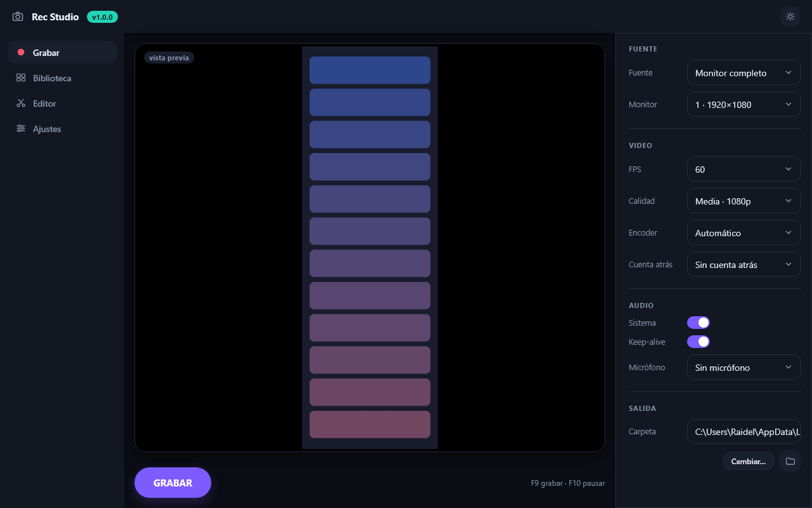
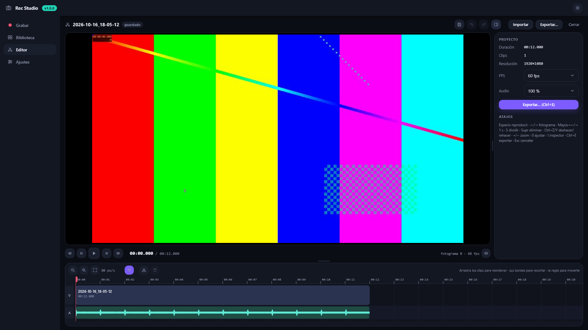
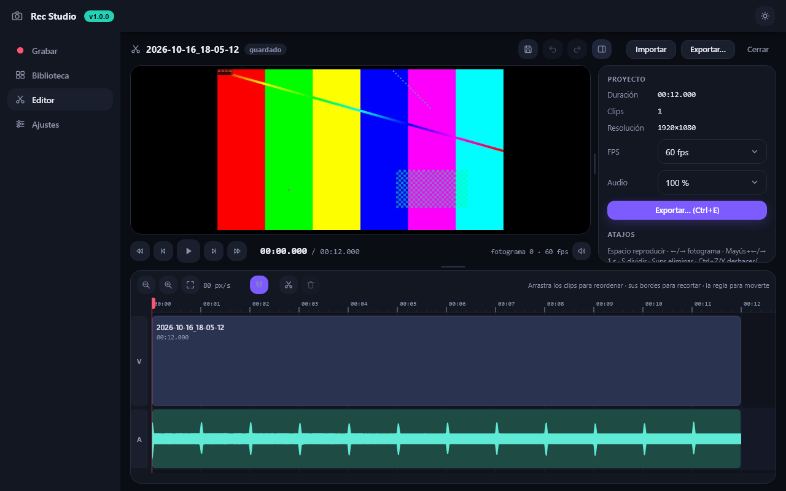
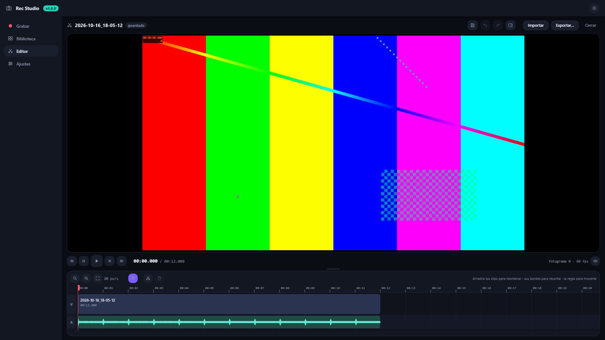
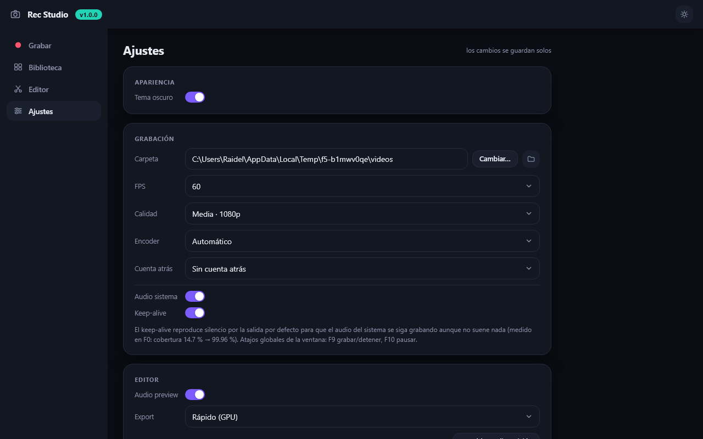
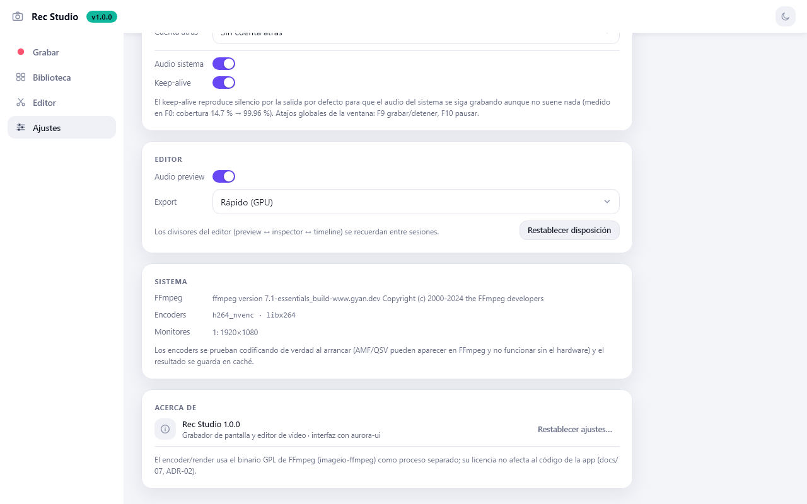

# 14 — F5: pulido y v1.0

> Implementado el **2026-10-16** según el roadmap ([06](06-roadmap.md), «F5 — Pulido y v1.0»)
> más los fallos de layout reportados al usar la app. Versión **1.0.0**. Capturas en
> `docs/assets/f5/` (`uv run python tools/f5_screenshots.py`), 13 tests nuevos en
> `tests/test_f5_pulido.py` y build verificado con `tools/check_build.py`.

## Qué se implementó

| Pieza | Contenido |
|---|---|
| Layout adaptable | La pantalla de Grabar, el editor y Ajustes ocupan el espacio de la ventana a cualquier tamaño: ni una imagen alta ni un panel largo empujan nada fuera de la ventana (ver «Bugs»). |
| Divisores del editor | `━` entre preview y timeline (arrastrar arriba = pistas más altas, abajo = preview más grande) y `┃` entre preview e inspector (240–560 px). Topes calculados con el tamaño real de la ventana: el preview nunca baja de 160 px de alto ni de 320 px de ancho. Se recuerdan entre sesiones. |
| Inspector ocultable | Tecla `I` o botón de panel en la barra del editor: el preview pasa a usar todo el ancho. |
| Pistas de alto variable | `ui/timeline.py`: la geometría vertical (`Tracks`) sale de `state.tl_tracks_extra` (60 % al video, 40 % al audio, con su waveform). El tope se aplica al dibujar, no al guardar: si la ventana encoge, las pistas también, y al volver a agrandarla recuperan el alto elegido. |
| Ajustes completos | Apariencia; grabación (carpeta con **selector nativo**, FPS, calidad, encoder, cuenta atrás, audio del sistema, keep-alive); editor (audio del preview, preset de export por defecto, «Restablecer disposición»); sistema (versión de FFmpeg, encoders que funcionan, monitores); «Acerca de» con la versión y «Restablecer ajustes…» (con confirmación). Todo se guarda solo. |
| Modales y teclado | `Esc` cierra la confirmación y el editor de región; `Intro` acepta la región. La referencia del editor de región cabe a lo ancho **y** a lo alto (monitores verticales). |
| Versión e icono | `recstudio.__version__ = "1.0.0"` (y `pyproject.toml`), chip `v1.0.0` en la cabecera, icono generado por `tools/make_icon.py` → `assets/icon.ico` (16–256 px) + `icon.png`. |
| Empaquetado | `[tool.aurora.build]` en `pyproject.toml` (onedir, sin consola, icono). `uv run aurora build` funciona tal cual. |
| Smoke test del exe | `Rec Studio.exe --smoke informe.json` (`src/recstudio/smoke.py`): importa el stack dentro del bundle, codifica un MP4 de 2 s con el FFmpeg incluido y lo reabre con PyAV, y construye la UI sin ventana pintando las 4 pantallas. `tools/check_build.py` hace build + smoke y falla si algo no está bien. |
| Ajustes atómicos | `Settings.save` escribe a `settings.json.tmp` + `os.replace`, serializado con un lock. |

## Capturas (reproducibles con `uv run python tools/f5_screenshots.py`)

| | |
|---|---|
|  |  |
| Región de 540×1600: el preview se ajusta y **GRABAR** sigue a la vista (antes quedaba en y≈3050). | Editor a 1920×1080: el frame se centra y crece con la ventana. |
|  |  |
| Divisor `━` arrastrado 140 px: pistas más altas, preview más bajo. | Inspector oculto (`I`): todo el ancho para el preview. |
|  |  |
| Ajustes completos. | Tema claro, sección Sistema y «Acerca de». |

## Bugs encontrados y su causa

| Síntoma | Causa | Arreglo |
|---|---|---|
| Al grabar una región muy vertical, el botón **GRABAR** desaparecía (fuera de la ventana). | `image(fit="contain", grow=1)` en una columna sin base 0: Taffy usa el tamaño intrínseco de la imagen (400×1600 → 1600 px de alto) como base del flex y la columna crece en vez de encoger. | `height=0` (y `width="100%"`) en la imagen y en sus contenedores con `grow=1`: el hueco lo decide la ventana. `min_height` 200 en el panel. |
| En el editor, al agrandar la ventana el frame se quedaba pequeño y pegado a la izquierda. | Mismo patrón: la imagen tomaba su tamaño intrínseco/proporcional y la columna la alineaba al inicio. | Contenedor centrado + `height=0`; con `fit="contain"` el frame llena el panel y se centra (prueba: 1176×426 dentro de un panel de 1190×440). |
| No se podía «redimensionar el frame». | No había forma: inspector (290 px) y timeline (alto fijo) estaban clavados. | Divisores arrastrables + inspector ocultable (arriba). |
| Ajustes no hacía scroll; con la ventana baja, «Acerca de» era inalcanzable. | La fila del shell (`row(grow=1)`) crecía con el contenido de la pantalla: el `scroll` nunca tenía menos alto que su contenido. | `row(grow=1, height=0)` + `box(grow=1, width=0)` en el shell; `row(..., height=0)` en Grabar. |
| Monitor vertical: el editor de región salía de la ventana. | La referencia se limitaba solo a 940 px de **ancho**. | `fit_reference()`: cabe en 940 de ancho y en el alto útil de la ventana. |
| `settings.json` vacío de forma intermitente (lo destapó un test nuevo). | El guardado con debounce corre en un `Timer` y podía coincidir con otro guardado: `write_text` trunca y un lector veía el archivo vacío; un cierre a mitad lo habría dejado en blanco. | Escritura atómica + lock. |
| Exe sin consola: riesgo de `WinError 6` al lanzar FFmpeg. | En PyInstaller `--windowed` no hay stdin válido que heredar. | `stdin=DEVNULL` en `platform.ffmpeg.run` (los `Popen` ya lo tenían). |
| El select de monitor se salía del panel de configuración. | Los `select` de Aurora 0.3 no truncan. | Etiqueta corta (`1 · 1920×1080`; el campo ya dice «Monitor»). |

## Mediciones

| Medida | Valor |
|---|---:|
| `aurora build --clean` (onedir) | 27 s |
| Bundle `dist/Rec Studio/` | 369 MB (F0/S6: 345 MB; numpy + PyAV + `opencv` de `dxcam` + FFmpeg) |
| Smoke del exe (imports + MP4 de 2 s + UI) | 4.1 s en frío, 0.7 s en caliente, rc=0 |
| Arranque hasta el primer frame (sin ventana, `pilot`) | 0.37 s (RNF-06 pide < 2 s con ventana: falta medirlo con ventana real) |
| RSS en reposo (sin ventana, 5 s tras arrancar) | ~96 MB (RNF-07 pide < 600 MB; falta medirlo con ventana y grabando) |
| Tests | 158 (145 + 13 de F5), ~21 s |

## Aprendizajes de Aurora 0.3 (añadidos a docs/05)

- **Base 0 en todo lo que crece**: cualquier contenedor `grow=1` cuyo contenido puede ser más
  grande que el hueco (imágenes, pantallas largas, paneles con scroll) necesita `height=0` (en
  columnas) o `width=0` (en filas). Si no, crece con el contenido en vez de encoger.
- **`on_scroll` como sensor de tamaño**: Aurora emite `ScrollEvent` también al hacer layout
  (con `width/height` del viewport). La navegación es un `scroll` sin contenido que desplazar y
  así la app conoce el alto útil de la ventana (`state.view_h`); no hay otra API para eso.
- No hay `wrap` en filas: listas de longitud variable como texto (`" · ".join(...)`).
- Los divisores siguen el patrón de F0/S5: `on_drag` con deltas acumulados desde la fase
  `start`, guardando el valor inicial al empezar.

## CI (`.github/workflows/ci.yml`)

Runner `windows-latest`, en cada push a `main`, PR o a mano:

1. **pytest** — `uv sync --locked` (Python de `.python-version`) + `uv run pytest -q`: unit,
   golden del filter graph, integración con el FFmpeg del wheel y UI con Pilot.
2. **build** (si pasan los tests) — `tools/check_build.py`: `aurora build --clean` + smoke del
   exe; sube `dist/Rec Studio/` como artefacto (14 días).

El runner no tiene monitor útil, GPU ni tarjeta de sonido, y no hace falta: los tests de
grabación usan sesiones falsas, la UI se construye sin ventana, las capturas de pantalla hacen
`pytest.skip`, el preview de audio queda mudo si no hay salida y los encoders por hardware se
marcan como no disponibles al probarlos. `PYTHONUTF8=1` evita que los ✓/✗ de los scripts
fallen con la consola cp1252. Los scripts de aceptación de `tools/` (f2–f4, soak, av_sync) no
entran en CI: necesitan escritorio y audio reales.

## Fuera de F5 / pendiente

- **`strings.py`** (textos centralizados): no se extrajo. La app es solo en español y los
  textos viven junto a su componente; extraerlos ahora solo añade una indirección. Se hará si
  llega la internacionalización (backlog).
- **CI**: configurado en `.github/workflows/ci.yml` (ver abajo), pero el repositorio todavía
  no tiene remoto en GitHub, así que **aún no se ha ejecutado** en un runner. La prueba en
  **máquina limpia** del flujo CU-1→CU-5 sigue pendiente (manual).
- RNF-06/07 con ventana real y grabando (las cifras de arriba son sin ventana).
- Instalador (Inno Setup) y bundle más ligero (`--exclude-module cv2`): post-v1, como en docs/02.
